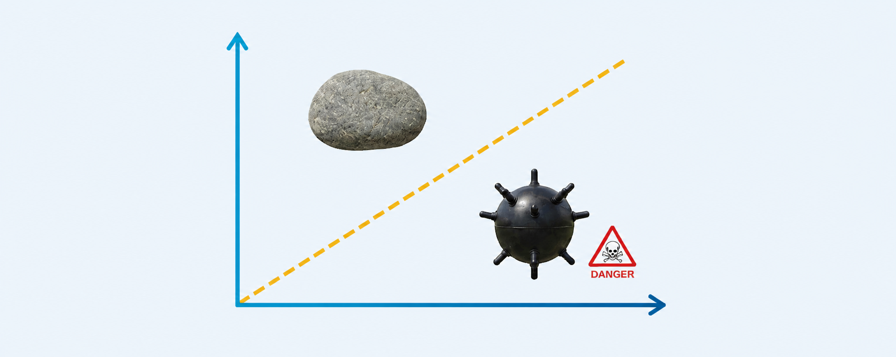
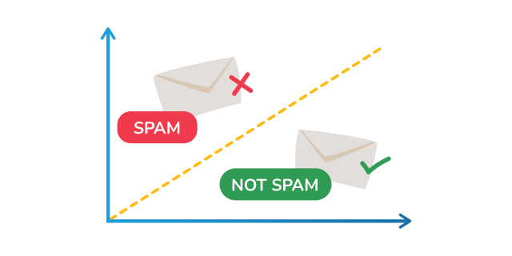
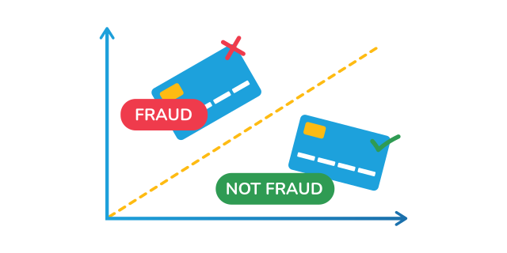
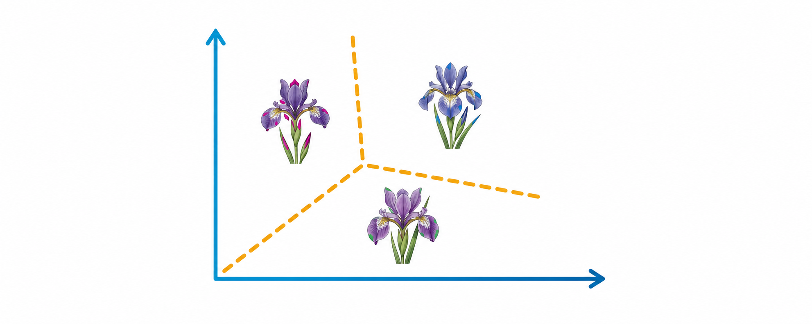

# Classification

Explore Java classifiers that predict binary decisions and multiclass labels from structured data.

  <a class="example-gallery-card" href="sonar-rock-mine-classification/">
    
    
      Binary classification
      <strong>Sonar Rock or Mine Classification</strong>
      <small>Classify reflected sonar measurements as rock or mine with a binary neural network.</small>
      View walkthrough &rarr;
    
  </a>
  <a class="example-gallery-card" href="email-spam-detection/">
    
    
      Binary classification
      <strong>Email Spam Detection</strong>
      <small>Transform labeled email features into a probability and a final spam or not-spam decision.</small>
      View walkthrough &rarr;
    
  </a>
  <a class="example-gallery-card" href="credit-card-fraud-detection/">
    
    
      Binary classification
      <strong>Credit Card Fraud Detection</strong>
      <small>Estimate whether an anonymized transaction is legitimate or fraudulent and inspect classification metrics.</small>
      View walkthrough &rarr;
    
  </a>
  <a class="example-gallery-card" href="iris-flower-classification/">
    
    
      Multiclass classification
      <strong>Iris Flower Classification</strong>
      <small>Predict one of three Iris species from four measurements with a Softmax output layer.</small>
      View walkthrough &rarr;
    
  </a>

