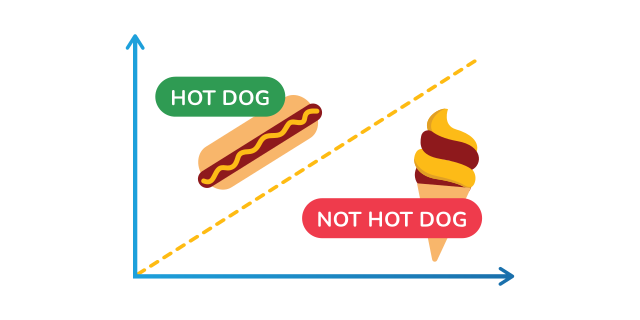
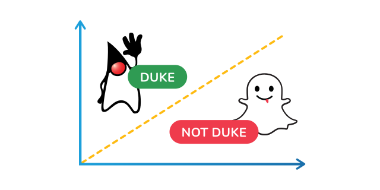
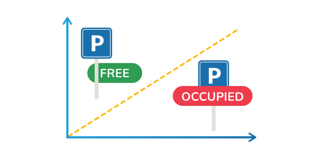
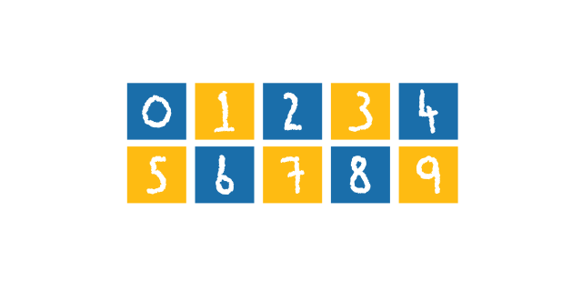
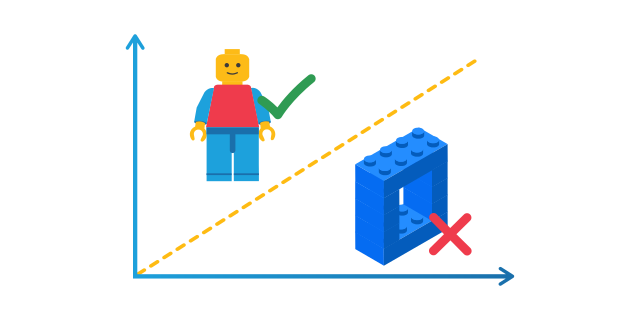
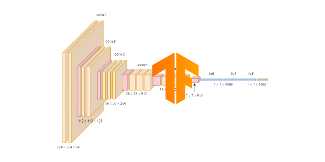

# Image Classification Examples

Explore convolutional neural networks that recognize objects, digits, logos, and real-world visual states.

  <a class="example-gallery-card" href="hotdog-nothotdog/">
    
    
      Image classification
      <strong>Hot Dog or Not Hot Dog</strong>
      <small>Train a binary CNN to distinguish <code>hot_dog</code> images from the <code>negative</code> class.</small>
      View walkthrough &rarr;
    
  </a>
  <a class="example-gallery-card" href="duke-logo-recognition/">
    
    
      Image classification
      <strong>Duke Logo Recognition</strong>
      <small>Recognize whether a prepared input image contains the Java Duke logo.</small>
      View walkthrough &rarr;
    
  </a>
  <a class="example-gallery-card" href="parking-lot-occupancy/">
    
    
      Image classification
      <strong>Parking Lot Occupancy</strong>
      <small>Classify a cropped parking-space image as occupied or free with a convolutional network.</small>
      View walkthrough &rarr;
    
  </a>
  <a class="example-gallery-card" href="handwritten-digit-recognition/">
    
    
      Multiclass image classification
      <strong>Handwritten Digit Recognition</strong>
      <small>Train a CNN on balanced 28-by-28 MNIST images and classify digits from <code>0</code> to <code>9</code>.</small>
      View walkthrough &rarr;
    
  </a>
  <a class="example-gallery-card" href="lego-figure-recognition/">
    
    
      Image classification
      <strong>Lego Figure Recognition</strong>
      <small>Train a binary RGB classifier to detect whether an image contains a Lego figure.</small>
      View walkthrough &rarr;
    
  </a>
  <a class="example-gallery-card example-gallery-card-advanced" href="tensorflow-vggnet16-import/">
    
    
      Image classificationAdvanced
      <strong>TensorFlow VGGNet16 Import</strong>
      <small>Import pretrained TensorFlow/ImageNet weights and run VGGNet16 inference without local training.</small>
      View walkthrough &rarr;
    
  </a>

