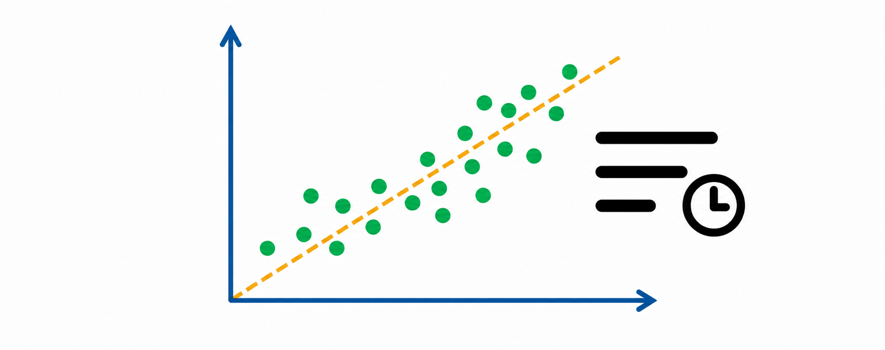
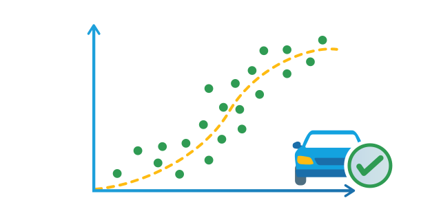
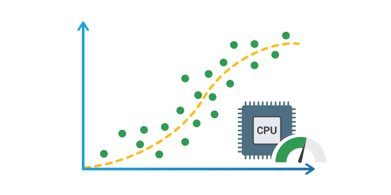
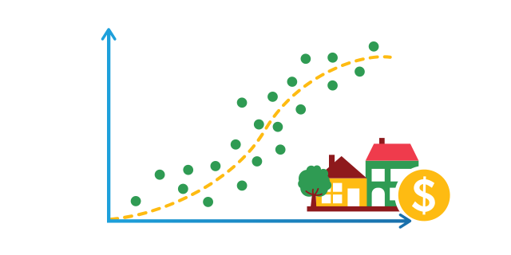

# Regression

Explore complete Java projects that train neural networks to predict continuous numerical values.

  <a class="example-gallery-card" href="sorting-execution-time-prediction/">
    
    
      Regression
      <strong>Sorting Execution Time Prediction</strong>
      <small>Predict sorting execution time from the number of comparisons with a compact 1-to-1 regression model.</small>
      View walkthrough &rarr;
    
  </a>
  <a class="example-gallery-card" href="insurance-payment-prediction/">
    
    
      Regression
      <strong>Insurance Payment Prediction</strong>
      <small>Estimate total insurance payments from claim counts while following a complete standardized training workflow.</small>
      View walkthrough &rarr;
    
  </a>
  <a class="example-gallery-card" href="computer-hardware-performance-prediction/">
    
    
      Regression
      <strong>Computer Hardware Performance Prediction</strong>
      <small>Predict published relative performance from multiple processor, memory, and channel measurements.</small>
      View walkthrough &rarr;
    
  </a>
  <a class="example-gallery-card" href="house-price-prediction/">
    
    
      Regression
      <strong>House Price Prediction</strong>
      <small>Learn a nonlinear relationship between a housing feature and normalized median home value.</small>
      View walkthrough &rarr;
    
  </a>

